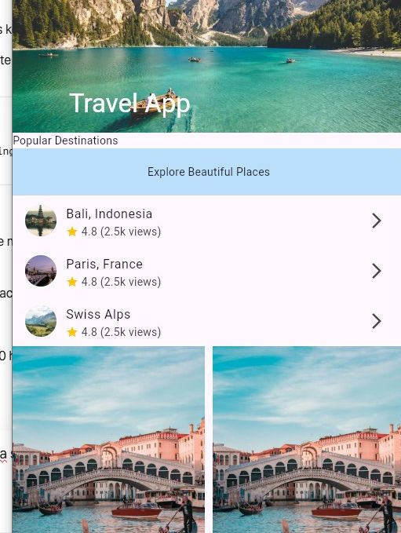
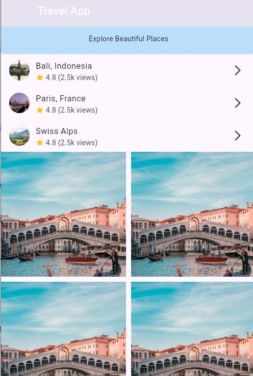
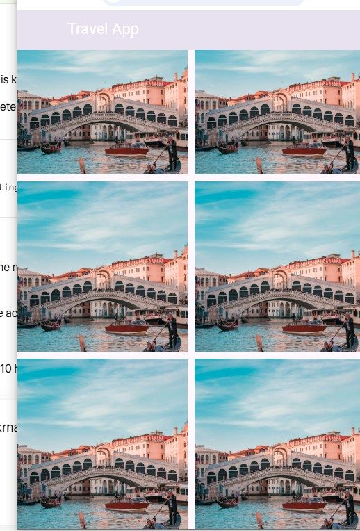

# Travel App UI - Flutter Slivers Project

A modern Travel App UI designed with Flutter Slivers.
Built with SliverAppBar, SliverList (Bali, Indonesia with 4.8 ratings) and SliverGrid (Venice).

## ✨ Features
- Custom Scroll with Slivers
- SliverAppBar with beautiful travel header
- SliverList for destinations (Bali, Paris, Swiss Alps)
- SliverGrid for Venice photos

## 📸 Screenshots

### App Screenshots

## 🛠️ Tech Used
- Flutter
- Dart
- Slivers (SliverAppBar, SliverList, SliverGrid)

## 🔗 Live Project
This project showcases advanced Flutter UI skills.
